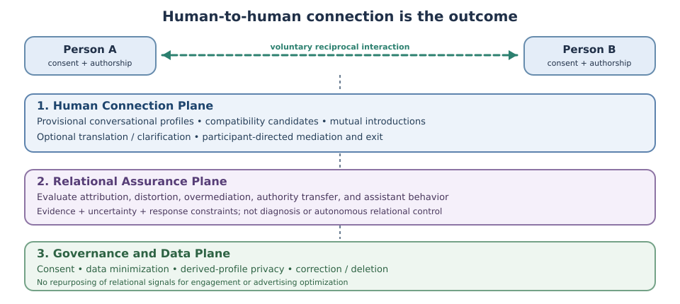

# Project Bridging

**Research status:** Conceptual investigation — proposed framework and falsifiable research agenda. **Not implemented or empirically validated.**

**Working paper:** [*AI as a Scaffold for Human Connection: A Framework for Discovery and Communication*](../research/project-bridging/ai-as-a-scaffold-for-human-connection.md) (v0.4.2, 17 October 2026; not peer reviewed).

## The question that started it

Some people enjoy sustained, exploratory conversations with AI and sometimes wish they could discover another human who would enjoy exploring the same questions. That does not make human–AI interaction an inferior experience or something to replace. Project Bridging explores whether AI might offer an **additional, voluntary way** to find mutually valued human conversations.

The question is not just whether two people have similar interests. They might approach unfamiliar ideas with compatible curiosity while disagreeing about the subject, or share an interest without enjoying the same style of discussion.

> Can AI responsibly increase opportunities for meaningful human connection by identifying potentially compatible people and supporting their communication, without manufacturing compatibility, diminishing human agency, or creating harmful dependency on the intermediary?

## Proposed approach

With explicit and separate permissions, patterns from repeated human–AI conversations might contribute to **provisional, contestable conversational representations**. A discovery mechanism could use those patterns alongside stated interests and preferences to identify possible partners, explain a limited rationale, and offer only excerpts or summaries authorized for sharing. Both people would independently decide whether to communicate.

If they do, optional scaffolding might assist with translation or clarification, but it must not silently rewrite away real differences or make the AI's interpretation substitute for the participants' meaning. Some participants might always value ongoing assistance. Others may choose not to use it. Neither reduced AI use nor continued AI use is a goal in itself.

*Proposed separation of Human Connection, Relational Assurance, and Governance and Data responsibilities. An unvalidated conceptual design, not an implemented safety system.*

## What the working paper contributes

The paper separates existing evidence from proposed mechanisms, alternative explanations, and open research questions. It outlines falsifiable hypotheses for discovery, profile contestability, communication support, relational assurance, and participant-directed assistance. It asks whether the added information from longitudinal interactions improves real, **mutually valued encounters** beyond simpler interest, preference, and participant-choice approaches.

A single meaningful conversation could count as a positive outcome even if it does not become an ongoing relationship. Conversely, an impressive model-derived compatibility score is not evidence that two people actually connected.

## What remains unknown

No Project Bridging dataset, matching implementation, deployed introduction system, or effectiveness study is reported. Whether inferred conversational patterns generalize from AI conversations to human encounters, improve discovery, avoid privacy and interpersonal harms, or justify a three-plane architecture remains untested. A simpler system may prove better.

A separately scoped empirical proposal, *Empowerment-Preserving AI Mediation*, is a proposed direction for investigating communication assistance; it is **not** presented here as completed or published research.

## Read the research

[**Read the full working paper →**](../research/project-bridging/ai-as-a-scaffold-for-human-connection.md)

The publication includes the research agenda, nine open research questions, methodological limitations, disclosure statement, and external references. The foundational *Empathy Bridge* hypothesis (2025) and July 2026 Project Bridging whitepaper are identified as unpublished origins, not represented as prior published research.
